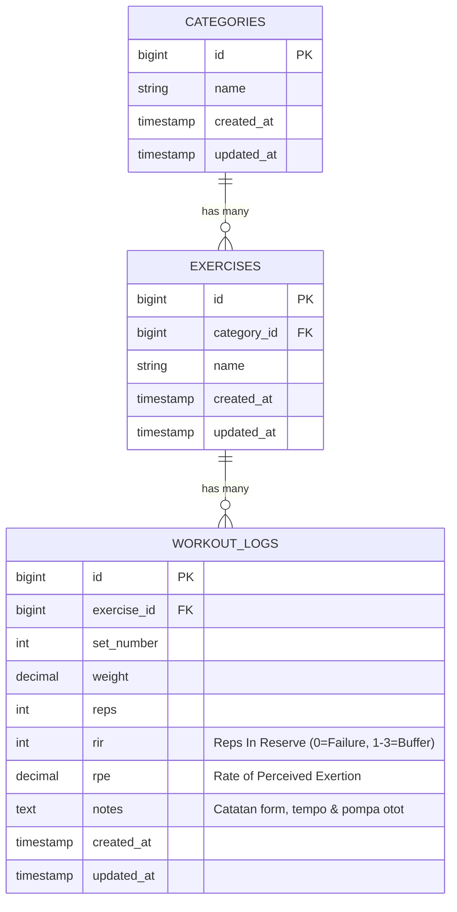

# Database Schema & Hypertrophy Data Model 🗄️

Dokumentasi struktur tabel dan relasi pada database **TrainSmart** untuk mendukung pencatatan program hipertrofi.

## Diagram Relasi Antar Tabel (ERD)

## Penjelasan Kolom Hipertrofi (`workout_logs`)

1. **`set_number`**: Urutan set yang dieksekusi (Set 1, Set 2, dst).
2. **`weight`**: Beban angkatan dalam satuan Kilogram (Kg), bertipe decimal untuk mendukung beban pecahan seperti `2.5kg` atau `12.5kg`.
3. **`reps`**: Jumlah repetisi sukses yang diselesaikan dengan *Full Range of Motion* (ROM).
4. **`rir` (Reps In Reserve)**: Parameter kunci hipertrofi ilmiah (0 = Gagal Otot / Failure, 1 = 1 repetisi sebelum gagal, 2 = 2 repetisi sebelum gagal).
5. **`rpe` (Rating of Perceived Exertion)**: Skala beban 6.0 – 10.0.
6. **`notes`**: Catatan teknis individual untuk progressive overload (contoh: tempo 3-1-1, posisi lubang bangku #3, rasa stretch di dada bawah).
